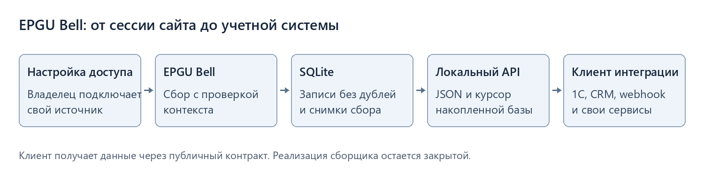

# В колокольчике Госуслуг было 66 уведомлений. Мой сборщик увидел только 20

Первый запуск выглядел убедительно: программа прочитала уведомления, записала JSON, при повторе не создала дублей. Я уже собирался подключать получателя, когда заметил признак продолжения списка. В кабинете было больше сообщений, чем в выгрузке.

После исправления получилось четыре страницы: 20, 20, 20 и 6 записей. С этой ошибки началась полезная часть EPGU Bell: проверять не только содержимое ответа, но и то, какую часть списка удалось получить.

Bell читает колокольчик Госуслуг в выбранном контексте организации, хранит уведомления в SQLite и отдает их через локальный HTTP API. Получателем может быть учетная система, CRM или обычный скрипт.

## Зачем отдельный читатель

Сотрудник работает в учетной системе, а сообщение приходит в кабинет Госуслуг. Приходится держать еще одну вкладку, переносить заголовок и решать, к какому делу он относится. Мне нужен был входящий поток данных, с которым дальше можно работать обычным кодом.

Пользователь входит в кабинет и подготавливает отдельную сессию. Установка закрепляется за одной организацией. По явной команде сборщик читает уведомления, сохраняет снимок и обновляет базу. Интегратор получает JSON со своего локального API; сессию кабинета ему передавать не требуется.



Уведомления сайта, статусы заявлений API ЕПГУ и сообщения Госпочты решают разные задачи. Текст «документы подписаны» может стать поводом открыть карточку, но сам по себе не заменяет проверку статуса конкретной услуги.

## Сначала проверяем, чью ленту прочитали

У одного пользователя бывает несколько организаций. Успешный вход еще не отвечает на вопрос, в каком контексте сейчас открыт кабинет.

Bell проверяет контекст при сборе, а получатель проверяет его при импорте. Если организация сменилась, сессия истекла или структура ответа неожиданно изменилась, сбор получает `needs_user_action`. Накопленные записи остаются в базе.

На живом TEST проверены непустая и пустая ленты. Импорт снимка другой организации отклонялся. Ноль должен означать прочитанный пустой список, а не потерянную авторизацию.

## У пагинации два конца

Первый находится на стороне источника. Сборщик проходит страницы, пока список не закончился или не достигнут предел. По умолчанию это 50 страниц и 1000 уникальных записей; пределы можно увеличить до 100 страниц и 2000 записей.

Повтор курсора, отсутствие новых ID или достижение ограничения дают `partial` с причиной остановки. В снимке схемы 1.3 есть `pages_fetched`, `view_exhausted`, `stop_reason` и `next_cursor`. Получатель различает завершенный обход и остановку посередине.

Второй конец находится у собственного API. Нельзя собрать страницы портала, а потом отдать клиенту только первую тысячу накопленных записей.

```http
GET /v1/notifications?limit=100
Authorization: Bearer LOCAL_BELL_TOKEN
```

Клиент читает `items` и `pagination`. Пока `has_more=true`, он передает `next_cursor` в следующем запросе с URL-кодированием. Курсор связан с поколением базы. Если между страницами прошел новый сбор, сервер вернет `409 page_snapshot_changed`, и обход начинается заново.

Опубликованный Python-клиент сначала собирает согласованную выдачу, затем сохраняет ее одной транзакцией. Ошибка на последней странице не оставляет у получателя половину нового снимка.

`view_exhausted=true` означает конец выбранного представления. Архив и другие фильтры могут содержать дополнительные сообщения, поэтому это поле не обещает выгрузку всей истории кабинета.

## Что сохраняется

В записи есть ID источника, заголовок, доступный текст списка, дата, категория, признак прочтения и ссылка. Отдельно хранятся `first_seen_at` и `last_seen_at`: когда сборщик впервые и в последний раз увидел запись.

Сокращенный пример, а не полный снимок:

```json
{
  "record": {
    "id": "ntf_example",
    "title": {
      "encoding": "base64",
      "charset": "utf-8",
      "data": "0KLQtdGB0YI="
    },
    "read_state": "unread",
    "body_coverage": "list_only"
  },
  "first_seen_at": "2026-11-20T10:00:00Z",
  "last_seen_at": "2026-11-20T10:05:00Z"
}
```

В `title` закодировано слово «Тест». Base64 задает формат текстового поля. Это обратимое кодирование, а не шифрование или защита от HTML. После декодирования сообщение нужно отображать как текст, например через `textContent`.

Повторный сбор обновляет запись по устойчивому ID с учетом контекста. Получатель сравнивает время наблюдения, чтобы старый экспорт не затер более свежую версию.

## Проверка на данных

На живой TEST-ленте два последовательных сбора дали по 66 уведомлений с четырех страниц. В SQLite осталось 66 записей. Заголовки, даты, категории и признаки прочтения сверялись с отдельным обходом ответов источника. Локальный API с размером страницы 17 отдал те же 66 ID без повторов.

Готовый rc.4 отдельно проверен на 1005 синтетических уведомлениях: шесть страниц источника и две страницы локального API. Повторный импорт добавил ноль записей. Проверка пакета включала авторизацию, курсоры, чужой контекст и отказ при поврежденных файлах.

Живые 66 записей проверялись на предрелизной сборке коллектора; воспроизводимая проверка опубликованного пакета выполняется на синтетических данных. Один прогон проверяет чтение источника, другой позволяет повторить проверку поставки без своего кабинета.

## Как попробовать

В [репозитории EPGU Bell](https://github.com/yellow444/epgu-bell) опубликованы документация, контракты и готовая [Free-сборка 0.2.0-rc.4](https://github.com/yellow444/epgu-bell/releases/tag/v0.2.0-rc.4). Она рассчитана на одну организацию на установку. Исходники приложения закрыты; клиентские примеры доступны отдельно.

Для Windows нужны Docker Desktop в режиме Linux containers и распакованный пакет. Демонстрацию можно запустить без учетной записи Госуслуг:

```powershell
$bellDemoRoot = Join-Path $env:LOCALAPPDATA ('EPGU Bell Demo ' + [guid]::NewGuid().ToString('N'))
.\tools\epgu-bell-setup.exe Verify
.\tools\epgu-bell-setup.exe Load
.\tools\epgu-bell-setup.exe Initialize --organization-id ORG-DEMO --install-root "$bellDemoRoot"
.\tools\epgu-bell-setup.exe Demo --install-root "$bellDemoRoot"
```

`Demo` использует синтетические сообщения без внешней сети. Пакет содержит хеши; [release-evidence.json](https://github.com/yellow444/epgu-bell/releases/download/v0.2.0-rc.4/release-evidence.json) связывает версию исходных входов, образ и архив поставки.

Для своего кабинета используется отдельная сессия по [руководству настройки](https://github.com/yellow444/epgu-bell/blob/main/docs/SESSION.md). Экспорт описывает текст списка, что видно по `body_coverage=list_only`. Полные карточки и вложения в этот контракт не входят.

## Дальше начинается интеграция

На выходе получается очередь входящих. Ее можно положить в регистр 1С, карточку Битрикс24, ServiceDesk или собственную базу. Для этого опубликованы [Python-клиент](https://github.com/yellow444/epgu-bell/blob/v0.2.0-rc.4/examples/integrations/import_notifications.py), [BSL-пример](https://github.com/yellow444/epgu-bell/blob/v0.2.0-rc.4/examples/1c/BellReader.bsl) и [рецепты автоматизации](https://github.com/yellow444/epgu-bell/blob/v0.2.0-rc.4/docs/AUTOMATION_RECIPES.md).

Практический критерий простой: получить запись дважды, сохранить одну входящую карточку и дать оператору понятный переход к ее разбору. После этого уже имеет смысл обсуждать маршрутизацию, дайджесты и связь с запросами к API.

## Кто делает Bell

Я Максим Ситников, yellow444, автор [EPGU Bell](https://github.com/yellow444/epgu-bell) и [EPGU](https://github.com/yellow444/epgu). Bell Free можно начать использовать для одной организации без покупки Multi. Работа с несколькими организациями и помощь с внедрением обсуждаются отдельно. Условия приложения, клиентских примеров и контрактов указаны в репозитории Bell; лицензия соседнего проекта EPGU их не заменяет.
